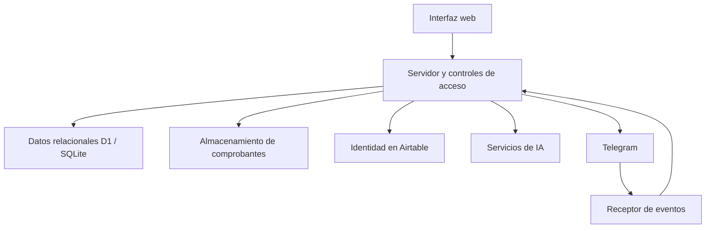

# Arquitectura pública / Public architecture

## Español

Vista conceptual derivada del código, sin dominios, IDs, tablas de identidad específicas ni configuración de alojamiento.

El servidor centraliza validación, sesiones, acceso a datos y llamadas externas. Los comprobantes se guardan separados de sus metadatos relacionales. La IA recibe entradas de texto, audio o documentos según la acción; el código valida los resultados estructurados y rechaza importes ambiguos. Los cálculos de resúmenes y recurrencia se realizan por reglas.

El flujo de identidad incluye contraseñas con scrypt, TOTP, cifrado AES-GCM para secretos persistidos y sesiones. Estos mecanismos describen la implementación, no constituyen una certificación de seguridad. Telegram tiene controles de secreto de webhook, miembros permitidos y deduplicación. La activación del receptor no fue comprobada.

La demo pública es un archivo HTML y un script independientes. No comparte servidor, almacenamiento ni integraciones con el sistema privado.

## English

Conceptual view derived from source code, excluding domains, identifiers, identity-specific tables, and hosting configuration.

The server centralizes validation, sessions, data access, and external calls. Receipt objects are stored separately from relational metadata. AI receives text, audio, or documents according to the action; structured results are validated and ambiguous amounts rejected. Summaries and recurrence calculations use deterministic rules.

Identity flows include scrypt passwords, TOTP, AES-GCM encryption for persisted secrets, and sessions. This describes implementation rather than a security certification. Telegram includes webhook-secret checks, authorized members, and deduplication. Receiver activation was not verified.

The public demo is an independent HTML file and script. It shares no server, storage, or integrations with the private system.
